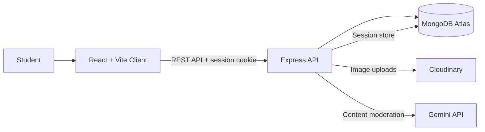
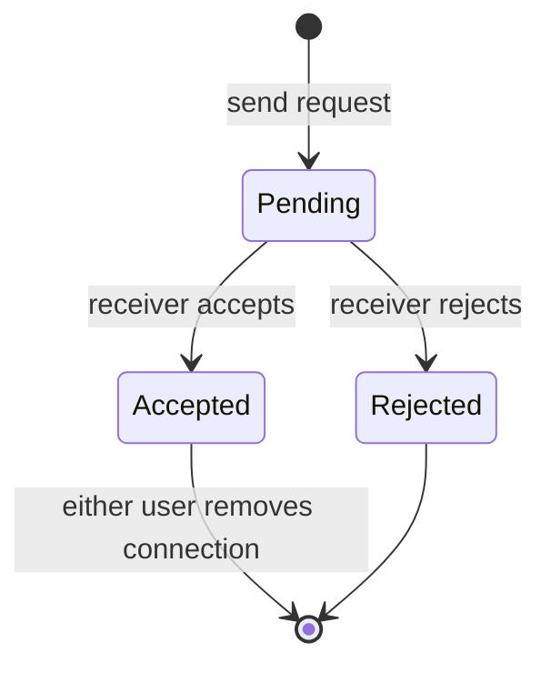

# ConnectSD — A Networking Platform Built for Students

> A full-stack MERN application where students build a professional profile, showcase skills and achievements, share posts, discover peers, and manage connection requests, with AI-assisted content moderation.

🔗 **Live demo:** [connectsd.vercel.app](https://connectsd.vercel.app/)

---

## 🎯 The Problem

Students usually have little to show a recruiter or a peer: no work history, no polished profile, and no network. General-purpose professional platforms are built around experienced professionals and job titles, so a first-year student's skills, projects and achievements get buried.

**ConnectSD gives students a focused space to:**

- Present themselves through structured sections (skills, languages, achievements, links) instead of a job-history-first profile.
- Find other students by name, username, or **skill**.
- Build a verified two-way network through a request/accept workflow.
- Share posts safely, with user-generated content checked by AI moderation.

---

## 🧠 Engineering Highlights

| Area                    | What I built                                                                                                                                                                                 | Why it matters                                                                                                                |
| ----------------------- | -------------------------------------------------------------------------------------------------------------------------------------------------------------------------------------------- | ----------------------------------------------------------------------------------------------------------------------------- |
| **Architecture**        | MERN stack with an MVC-style Express backend (`router → controller → model`, plus `middleware`, `config`, `utils`) and a component-based React client with a dedicated `services/` API layer | Clear separation of concerns; each layer can be changed without touching the others                                           |
| **Auth & sessions**     | `bcrypt` password hashing, cookie-based sessions via `express-session`, persisted in MongoDB with `connect-mongodb-session`                                                                  | Sessions survive server restarts, and passwords are never stored in plain text                                                |
| **Data integrity**      | Compound unique index on connection `(sender, receiver)`                                                                                                                                     | Duplicate requests are rejected by the **database**, not just by application code, so they can't slip through race conditions |
| **Connection workflow** | Dedicated connection model with `pending / accepted / rejected` states, plus send, accept, reject, remove and status endpoints                                                               | Models the real-world relationship cleanly instead of overloading the user document                                           |
| **Media pipeline**      | Multer → Cloudinary; URL and `public_id` stored in MongoDB                                                                                                                                   | Images survive redeploys on ephemeral hosts like Render, and the `public_id` enables cleanup on delete                        |
| **Search UX**           | Debounced, skill-aware student search                                                                                                                                                        | Fewer API calls while typing and a more responsive UI                                                                         |
| **Validation**          | `express-validator` on server-side inputs                                                                                                                                                    | The API doesn't trust the client                                                                                              |
| **AI moderation**       | Google Gemini API integration to flag inappropriate user-generated content                                                                                                                   | Proactive safety layer for a student (often minor-adjacent) community                                                         |
| **Deployment**          | Vercel (client), Render (API), MongoDB Atlas, Cloudinary, with cross-origin cookie auth over HTTPS                                                                                           | A real production setup, not just localhost                                                                                   |

---

## 🧩 Problems I Solved

### 1. Duplicate connection requests

**Problem:** Two users could end up with multiple requests between them, for example from double clicks or concurrent requests, which corrupts the network graph.
**Solution:** A compound unique index on sender and receiver enforces uniqueness at the database level. Application checks alone can't guarantee this under concurrency.

### 2. Modeling complex connection states

**Problem:** Pending, accepted, rejected and removed relationships don't fit as a simple array on the user document.
**Solution:** A separate connection collection with a status field. One query returns sent requests, received requests and accepted connections, and each status change has its own endpoint.

### 3. Images disappearing after deployment

**Problem:** Hosts like Render use ephemeral file systems, so locally stored uploads are lost on redeploy.
**Solution:** Uploads go through Multer to Cloudinary. MongoDB stores only the URL and `public_id`, which keeps the backend stateless and the images persistent.

### 4. Wasteful search requests

**Problem:** Firing an API call on every keystroke floods the backend and makes the UI flicker.
**Solution:** Debounced input on the client, so a request goes out only after the user pauses typing. Search covers name, username and skills.

### 5. Unstructured student profiles

**Problem:** A single free-text "bio" can't showcase a student's technical background.
**Solution:** Modular profile sections (headline, about, skills, languages, achievements, social links), each with its own update endpoint, so sections can be edited independently.

### 6. Inappropriate user-generated content

**Problem:** An open posting platform invites spam and harmful content.
**Solution:** Gemini-based moderation checks content for inappropriate material.

<!-- TODO(author): state where in the flow moderation runs (before saving a post? on text, images, or both?) and what happens to flagged content. -->

### 7. Cookie authentication across two domains

**Problem:** The frontend (Vercel) and backend (Render) live on different origins, so session cookies need correct CORS and cookie settings to work in production.
**Solution:** Credentialed requests from the client, `FRONTEND_URL` as an exact-origin CORS allowlist, and HTTPS in production.

<!-- TODO(author): confirm and add the exact cookie flags you used (sameSite, secure, trust proxy) and what the failure looked like before you fixed it. This is a strong interview story. -->

---

## 🏗️ Architecture



### Request lifecycle

```
Client (services/) → Router → Auth middleware → Validator → Controller → Mongoose Model → Response
```

### Connection state machine



---

## ✨ Features

**Authentication**

- Registration and login with bcrypt-hashed passwords
- Cookie sessions persisted in MongoDB
- Session status check and logout

**Profiles**

- Headline, about, academic details, skills, languages, achievements, social links
- Profile picture upload
- View other students' profiles

**Posts and feed**

- Image + text posts stored on Cloudinary
- Feed of recent posts, personal post list
- Like / unlike, delete

**Discovery and connections**

- Search by name, username, or skill
- Send, accept, reject and remove connections
- Connection status check between any two users

**UI**

- Responsive React interface with Tailwind CSS
- Client-side routing, animated components (Motion), React Icons

---

## 🧰 Tech Stack

| Layer                | Technologies                                                 |
| -------------------- | ------------------------------------------------------------ |
| Frontend             | React, Vite, React Router, Tailwind CSS, Motion, React Icons |
| Backend              | Node.js, Express.js                                          |
| Database             | MongoDB, Mongoose                                            |
| Auth                 | `bcrypt`, `express-session`, `connect-mongodb-session`       |
| Validation & uploads | `express-validator`, Multer                                  |
| Media                | Cloudinary                                                   |
| AI                   | Google Gemini API                                            |
| Deployment           | Vercel, Render, MongoDB Atlas                                |

---

## 📁 Project Structure

```
Networking_System/
├── client/
│   ├── public/
│   └── src/
│       ├── components/
│       │   ├── authentication/
│       │   ├── dashboard/
│       │   ├── landing/
│       │   ├── navigation/
│       │   └── userProfile/
│       ├── services/        # Frontend API calls
│       ├── App.jsx
│       └── main.jsx
├── server/
│   ├── config/              # Cloudinary configuration
│   ├── controller/          # Request handlers and business logic
│   ├── middleware/          # Auth and upload middleware
│   ├── model/               # Mongoose schemas
│   ├── router/              # Route definitions
│   ├── utils/               # Shared utilities
│   └── app.js
└── README.md
```

---

## 🗃️ Data Models

- **User profile:** credentials (hashed), academic info, skills, languages, links, achievements, profile-image metadata
- **User post:** author, text, image URL, Cloudinary `public_id`, likes, timestamps
- **User connection:** sender, receiver, status, timestamps, with a **unique compound index on (sender, receiver)**

---

## 🔌 API Overview

All routes are mounted under `/api/user`.

| Area    | Method & path                                                                                                                            | Purpose                                    |
| ------- | ---------------------------------------------------------------------------------------------------------------------------------------- | ------------------------------------------ |
| Auth    | `POST /signup` · `POST /login` · `GET /status` · `POST /postLogout`                                                                      | Register, log in, check session, log out   |
| Profile | `GET /profile` · `POST /profile/complete` · `PUT /profile/update`                                                                        | Read, complete and update profile          |
| Profile | `PUT /profile/language` · `/profile/skills/update` · `/profile/skills/delete` · `/profile/links/update` · `/profile/achievements/update` | Granular section updates                   |
| Posts   | `POST /profile/create-post` · `GET /profile/all-post` · `DELETE /profile/post/delete`                                                    | Create, list own, delete                   |
| Feed    | `GET /getallPost` · `PUT /post/:postId`                                                                                                  | Feed and like toggle                       |
| Search  | `POST /search` · `GET /search/:userId`                                                                                                   | Find students, view profile                |
| Network | `POST /myNetwork` · `GET /myNetwork/connections`                                                                                         | Send request, list sent/received/connected |
| Network | `PATCH /myNetwork/:id/accepted` · `/rejected` · `/removeConnection` · `GET /myNetwork/:id/status`                                        | Manage a connection                        |

> Known cleanup item: the follow-toggle route is spelled `/follwers/:userId` in code. Fix it in backend and frontend together.

---

## 🚀 Getting Started

### Prerequisites

Node.js and npm, a MongoDB database (Atlas works), a Cloudinary account, and a Google Gemini API key.

### Backend

```bash
git clone https://github.com/harshrai2910/Networking_System.git
cd Networking_System/server
npm install
```

Create `server/.env`:

```env
PORT=3006
MONGODB_PATH=mongodb+srv://<username>:<password>@<cluster>/<database>
SESSION_SECRET=replace_with_a_long_random_secret
FRONTEND_URL=http://localhost:5173
NODE_ENV=development

CLOUDINARY_CLOUD_NAME=your_cloud_name
CLOUDINARY_API_KEY=your_api_key
CLOUDINARY_API_SECRET=your_api_secret

GEMINI_API_KEY=your_gemini_api_key   # confirm the exact variable name used in code
```

```bash
npm start
```

### Frontend

```bash
cd ../client
npm install
echo "VITE_API_URL=http://localhost:3006" > .env
npm run dev
```

---

## 🔐 Deployment Notes

- Set `FRONTEND_URL` to the exact frontend origin (no path) and `VITE_API_URL` to the backend base URL (no trailing slash).
- Cookie auth across two domains requires HTTPS plus correct CORS and cookie settings.
- Configure all backend secrets on the host, never in the repo.

---

## 🔭 What I'd Build Next

- Real-time chat and notifications (WebSockets)
- Pagination or infinite scroll on the feed
- Rate limiting and secure headers (`helmet`)
- Comments on posts and richer feed ranking
- Automated tests for connection logic and auth
- Rename the `follwers` route and add API documentation (OpenAPI/Swagger)

---

## 👤 Author

**Harsh Rai**, BCA student and MERN stack developer
GitHub: [@harshrai2910](https://github.com/harshrai2910)
