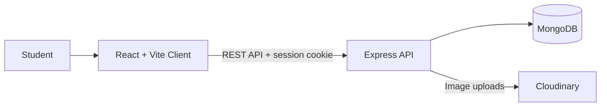

# ConnectSD — Student Networking Platform

ConnectSD is a student-focused networking platform where students can build a professional profile, showcase their skills and achievements, share posts, discover other students, and manage connection requests.

🔗 **Live demo:** [connectsd.vercel.app](https://connectsd.vercel.app/)

## ✨ Features

### Authentication

- Student registration and login.
- Password hashing with `bcrypt`.
- Cookie-based sessions managed with Express Session and MongoDB session storage.

### Student Profiles

- Complete and update academic and personal profile details.
- Add a headline, about section, skills, languages, achievements, and social links.
- Upload a profile picture.
- View other students' profiles and skills.

### Posts and Feed

- Create image posts with text content.
- View your posts and browse a feed of recent posts.
- Like and unlike posts.
- Delete posts.
- Store post images on Cloudinary rather than relying on local server storage.

### Student Discovery and Connections

- Search students by name, username, or skill.
- Send connection requests.
- Accept or reject received requests.
- View sent requests and existing connections.
- Check a user's connection status and remove an accepted connection.

### User Interface

- Responsive React interface.
- Client-side navigation with React Router.
- Tailwind CSS styling, animated UI elements, and React Icons.

## 🧰 Tech Stack

| Layer                  | Technologies                                                             |
| ---------------------- | ------------------------------------------------------------------------ |
| Frontend               | React, JavaScript, Vite, React Router, Tailwind CSS, Motion, React Icons |
| Backend                | Node.js, Express.js                                                      |
| Database               | MongoDB, Mongoose                                                        |
| Authentication         | `bcrypt`, `express-session`, `connect-mongodb-session`                   |
| Validation and uploads | `express-validator`, Multer                                              |
| Image storage          | Cloudinary                                                               |
| Deployment options     | Vercel (frontend), Render (backend), MongoDB Atlas, Cloudinary           |

## 🏗️ Architecture

The frontend calls the Express REST API and includes session cookies with requests. The backend handles authentication, profile and post operations, connection management, and database access. Uploaded images are sent to Cloudinary; their URLs and Cloudinary public IDs are stored in MongoDB.



## 📁 Project Structure

```text
Networking_System/
├── client/
│   ├── public/
│   ├── src/
│   │   ├── components/
│   │   │   ├── authentication/
│   │   │   ├── dashboard/
│   │   │   ├── landing/
│   │   │   ├── navigation/
│   │   │   └── userProfile/
│   │   ├── services/          # Frontend API calls
│   │   ├── App.jsx
│   │   ├── App.css
│   │   ├── index.css
│   │   └── main.jsx
│   ├── package.json
│   └── vite.config.js
├── server/
│   ├── config/                # Cloudinary configuration
│   ├── controller/            # Request handlers and business logic
│   ├── middleware/            # Authentication and upload middleware
│   ├── model/                 # Mongoose schemas
│   ├── router/                # Express route definitions
│   ├── utils/                 # Shared server utilities
│   ├── app.js
│   └── package.json
├── .gitignore
└── README.md
```

## 🚀 Getting Started

### Prerequisites

- Node.js and npm
- A MongoDB database (MongoDB Atlas is suitable for cloud deployment)
- A Cloudinary account for profile and post images

### 1. Clone the repository

```bash
git clone https://github.com/harshrai2910/Networking_System.git
cd Networking_System
```

### 2. Configure and run the backend

```bash
cd server
npm install
```

Create a `server/.env` file with the following variables:

```dotenv
PORT=3006
MONGODB_PATH=mongodb+srv://<username>:<password>@<cluster>/<database>?retryWrites=true&w=majority
SESSION_SECRET=replace_with_a_long_random_secret
FRONTEND_URL=http://localhost:5173
NODE_ENV=development

CLOUDINARY_CLOUD_NAME=your_cloudinary_cloud_name
CLOUDINARY_API_KEY=your_cloudinary_api_key
CLOUDINARY_API_SECRET=your_cloudinary_api_secret
```

Replace the example values with your own credentials. `MONGODB_PATH` is used by both Mongoose and the MongoDB-backed session store. For a local MongoDB instance, use its local connection URI instead.

Start the API:

```bash
npm start
```

The backend defaults to `http://localhost:3006`. The current `start` script uses Nodemon; `node app.js` can be used to start the server directly.

### 3. Configure and run the frontend

Open a second terminal from the repository root:

```bash
cd client
npm install
```

Create `client/.env`:

```dotenv
VITE_API_URL=http://localhost:3006
```

Start the Vite development server:

```bash
npm run dev
```

Vite will print the local frontend URL, normally `http://localhost:5173`.

### 4. Useful frontend commands

Run these from the `client` directory:

```bash
npm run dev       # Start development server
npm run build     # Create a production build
npm run preview   # Preview the production build
npm run lint      # Run ESLint
```

## 🔐 Environment and Deployment Notes

- Never commit `.env` files or real credentials. Use environment variables provided by your hosting platform.
- Set `FRONTEND_URL` to the exact origin of the deployed frontend, without a path.
- Set `VITE_API_URL` to the deployed backend's base URL, without a trailing slash.
- Configure `MONGODB_PATH`, `SESSION_SECRET`, and all Cloudinary variables on the backend host.
- Because authentication uses cookies across the frontend and backend, production deployments must use HTTPS and correctly configured CORS and cookie settings.
- A typical deployment uses `client` as the Vercel project root and `server` as the backend service root. Configure the backend start command to run `node app.js` and make sure the host supplies `PORT`.

## 🔌 API Overview

The backend mounts its routers under `/api/user`.

| Area           | Method and path                                  | Purpose                                                    |
| -------------- | ------------------------------------------------ | ---------------------------------------------------------- |
| Authentication | `POST /api/user/signup`                          | Register an account                                        |
| Authentication | `POST /api/user/login`                           | Log in                                                     |
| Authentication | `GET /api/user/status`                           | Check the current session                                  |
| Authentication | `POST /api/user/postLogout`                      | Log out                                                    |
| Profile        | `GET /api/user/profile`                          | Retrieve the current profile                               |
| Profile        | `POST /api/user/profile/complete`                | Complete a profile, including an image upload              |
| Profile        | `PUT /api/user/profile/update`                   | Update profile details                                     |
| Profile        | `PUT /api/user/profile/language`                 | Update languages                                           |
| Profile        | `PUT /api/user/profile/skills/update`            | Update skills                                              |
| Profile        | `PUT /api/user/profile/skills/delete`            | Remove a skill                                             |
| Profile        | `PUT /api/user/profile/links/update`             | Update social links                                        |
| Profile        | `PUT /api/user/profile/achievements/update`      | Update achievements                                        |
| Posts          | `POST /api/user/profile/create-post`             | Create an image post                                       |
| Posts          | `GET /api/user/profile/all-post`                 | Retrieve the current user's posts                          |
| Posts          | `DELETE /api/user/profile/post/delete`           | Delete a post                                              |
| Posts          | `GET /api/user/getallPost`                       | Retrieve feed posts                                        |
| Posts          | `PUT /api/user/post/:postId`                     | Toggle a post like                                         |
| Student search | `POST /api/user/search`                          | Search students                                            |
| Student search | `GET /api/user/search/:userId`                   | Retrieve a student's profile                               |
| Connections    | `POST /api/user/myNetwork`                       | Send a connection request                                  |
| Connections    | `GET /api/user/myNetwork/connections`            | Retrieve sent requests, received requests, and connections |
| Connections    | `PATCH /api/user/myNetwork/:id/accepted`         | Accept a request                                           |
| Connections    | `PATCH /api/user/myNetwork/:id/rejected`         | Reject a request                                           |
| Connections    | `PATCH /api/user/myNetwork/:id/removeConnection` | Remove a connection                                        |
| Connections    | `GET /api/user/myNetwork/:id/status`             | Check connection status                                    |

The current follow-toggle endpoint is spelled `/api/user/follwers/:userId` in the code. It is listed here by its actual path; consider correcting the spelling in both the backend and frontend together.

## 🗃️ Data Models

- **User profile:** login credentials, academic and profile information, skills, links, achievements, and profile-image metadata.
- **User post:** author, text content, image URL, Cloudinary public ID, likes, and timestamps.
- **User connection:** sender, receiver, request status, and timestamps.

## 🛠️ Engineering I Did

- **Full-Stack Architecture:** Designed and developed a student networking platform using the MERN stack, with modular React components and an MVC-based Express.js backend.
- **Authentication & Authorization:** Implemented user registration, login, session management, and password hashing using bcrypt.
- **Database Design:** Designed MongoDB schemas for user profiles, posts, and connections, including a compound unique index to prevent duplicate connection requests.
- **Networking System:** Built connection workflows to send requests, manage received requests, and maintain connection status.
- **Media Management:** Integrated Multer and Cloudinary to handle image uploads and store publicly accessible media URLs.
- **Search & User Experience:** Implemented debounced, skill-based user search, responsive interfaces, and profile management.
- **AI Integration:** Integrated Google's Gemini API for content moderation to help identify inappropriate user-generated content.

## 🧩 Problems I Solved

- **Duplicate Connection Requests:** Used a compound database index on sender and receiver to enforce connection uniqueness at the database level.
- **Unnecessary Search Requests:** Implemented debouncing to reduce API calls while users type search queries.
- **Image Persistence Across Deployments:** Integrated Cloudinary instead of relying on local server storage, ensuring uploaded images remain accessible independently of the backend's local filesystem.
- **Complex Connection States:** Designed a dedicated connection model to manage request senders, receivers, and pending or accepted states.
- **Unstructured Student Profiles:** Created modular profile sections for skills, achievements, languages, and professional links, allowing students to showcase their technical backgrounds.
- **Inappropriate User-Generated Content:** Integrated AI-powered moderation to help detect potentially inappropriate content before it spreads across the platform.

## 👤 Author

**Harsh Rai** — BCA student and MERN stack developer

- GitHub: [@harshrai2910](https://github.com/harshrai2910)
- Repository: [Networking_System](https://github.com/harshrai2910/Networking_System)
- Live demo: [connectsd.app](https://connectsd.vercel.app/)
